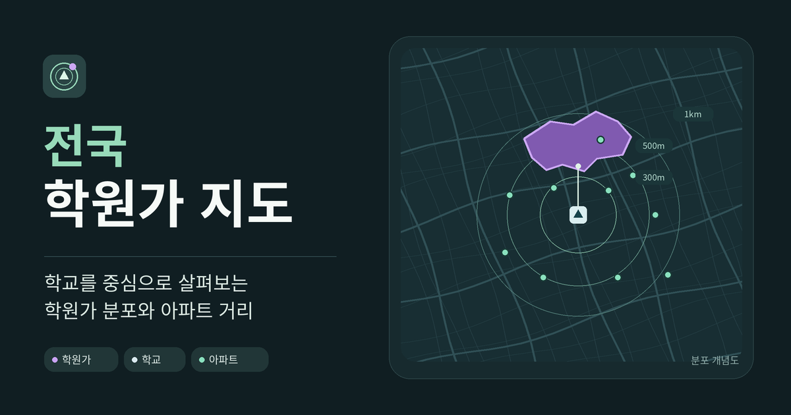

# 스쿨맵

학교를 중심으로 학원이 어느 방향에 모여 있는지 살펴보고, 주변 아파트에서 학원가까지의 거리를 비교하는 전국 지도입니다.



[스쿨맵](https://schoolmap-pearl.vercel.app) · [기존 공개 지도](https://hakwon.zap15.chatgpt.site)

## 지도 사용법

- **학원가 선택** · 주소에 `?rank=12`처럼 전국 학원가 순위를 붙이면 해당 학원가가 먼저 열립니다. 주소에 순위가 없거나 해당 순위가 없으면 상위 30개 학원가 중 한 곳이 무작위로 열립니다. 공동 순위에서는 학원가 ID 순으로 첫 번째 거점을 엽니다. 초록색 밀집 경계에서 300m·500m·1km 이내로 확장한 학군지를 선택할 수 있습니다. 자유 탐색에서는 지도 위 경계를 눌러 해당 학원가를 엽니다.
- **장소 검색** · 학교, 학원가, 동네, 아파트를 한 번에 검색합니다. 학교 약칭과 한글 초성, 학원가 대표 도로명과 전국 순위(예: `12위`)도 사용할 수 있습니다. 아파트 검색 결과의 지역 표시는 인근 학원가 기준입니다.
- **최근 검색** · 검색창을 열면 같은 브라우저에서 최근 선택한 장소를 다시 열 수 있습니다. 반복 검색에는 저장된 결과를 재사용합니다.
- **학교 선택** · 검색창에서 학교를 찾거나 지도 위 주황색 학교 마커를 누르세요. 학교를 중심으로 300m·500m·1km 동심원이 표시되고, 현재 반경에서 학원가에 속한 학원 수를 동서남북 등 8방위로 비교할 수 있습니다.
- **겹친 시설 보기** · 아파트 묶음은 두 건물이 겹친 아이콘으로 표시합니다. 학교는 별도로 묶이며 학교 아이콘을 사용합니다. 아이콘을 누르면 지도가 확대되고, 같은 위치의 시설은 펼쳐져 하나씩 선택할 수 있습니다.
- **학교 정보** · 학교를 선택하면 재학생과 학급, 교사 수, 학급당 학생 수와 전년 대비 재학생 증감을 확인할 수 있습니다. 학교알리미 원문에서 학교별 공시를 더 볼 수 있습니다.
- **아파트 선택** · 단지를 누르면 가장 가까운 학원가와 경계까지의 최단 직선거리가 표시됩니다. 단지 대표점이 학원가 경계 안에 있으면 **내부 0m**입니다. 도보 경로는 선택한 학교나 학원가까지의 별도 조회 결과입니다.

## 로컬에서 열기

저장소 루트에서 아래 명령을 실행한 후 [http://localhost:8000](http://localhost:8000)을 엽니다. Python 3의 기본 HTTP 서버를 사용합니다.

```sh
python3 -m http.server 8000 --directory dist
```

사이트는 HTML·CSS·JavaScript로 구성되어 있으며 Leaflet을 포함합니다. 배경지도 타일과 도보 경로 조회에는 인터넷 연결이 필요합니다. 시설 데이터는 패키지에 포함된 스냅샷을 사용합니다.

## Vercel에 배포하기

저장소 루트를 Vercel 프로젝트에 연결하면 `vercel.json`에 따라 `dist/`가 정적 사이트로 배포됩니다.

## GitHub Pages에 배포하기

1. ZIP을 풀고 README, `dist/`, `.github/`가 저장소 루트에 오도록 GitHub 저장소에 커밋합니다. 숨김 폴더인 `.github/`까지 포함하세요.
2. 저장소의 **Settings → Pages → Build and deployment → Source**에서 **GitHub Actions**를 선택합니다.
3. **Actions → Deploy map to GitHub Pages → Run workflow**를 실행합니다. 이후 `main` 브랜치로 푸시하면 다시 배포됩니다.
4. 워크플로가 성공하면 **Settings → Pages**에 표시된 공개 주소를 엽니다.

워크플로는 `dist/`를 배포하고, 사이트 주소에서 **OG 이미지의 절대 URL**을 자동으로 만듭니다. 프로젝트 주소에 저장소 이름이 들어 있거나 사용자 정의 도메인을 쓰는 경우에도 Pages가 제공하는 주소를 사용합니다.

[GitHub Pages 공식 배포 문서](https://docs.github.com/en/pages/getting-started-with-github-pages/using-custom-workflows-with-github-pages)

## 파일 구성

| 경로 | 내용 |
| --- | --- |
| `dist/index.html` | 화면 구조, 메타데이터 및 학원가 데이터 |
| `dist/app.js`, `dist/start.js`, `dist/search.js` | 순위, 초기 화면 및 장소 검색 |
| `dist/map.js`, `dist/school.js`, `dist/explore.js` | 지도 표시, 학교 반경, 자유 탐색 및 도보 경로 조회 |
| `dist/clusters.js`, `dist/cluster-data.js` | 학교 중심 방향별 학원 수와 단지별 최단 학원가 거리 |
| `dist/school-details/` | 시도별 학교알리미 공시 자료 |
| `dist/places.js`, `dist/ranges/` | 학교·아파트 대표 좌표와 학원가별 확장 범위 |
| `dist/assets/og-image.png` | 링크 공유용 OG 이미지 · 1200 × 630 |
| `dist/assets/favicon.ico`, `dist/assets/favicon.png` | 브라우저 탭 아이콘 · ICO 다중 크기, PNG 64 × 64 |
| `dist/vendor/` | Leaflet, Leaflet MarkerCluster와 해당 라이선스 |
| `.github/workflows/pages.yml` | GitHub Pages 배포 설정 |

## 데이터와 거리 기준

| 데이터 | 패키지 기준 | 출처 |
| --- | --- | --- |
| 학원·교습소 | 2026년 10월 31일 기준 등록시설. 동별 순위는 전 분야 개원 학원 기준 | [나이스](https://open.neis.go.kr/portal/data/service/selectServicePage.do?infId=OPEN19220231012134453534385&infSeq=3) |
| 주소 좌표 | 2026년 9월 30일 기준 상가 주소와 매칭 | [소상공인시장진흥공단 상가정보](https://www.data.go.kr/data/15083033/fileData.do) |
| 학원가 | 반경 100m에 등록 학원 20곳 이상 및 서로 다른 주소 좌표 4곳 이상이 있는 곳을 중심으로 밀집 경계를 만들고 인접 영역을 묶어 464곳을 표시 | 위 학원·상가 자료를 가공 |
| 학교 | 2026년 10월 1일 기준 운영 중인 전국 초·중·고 12,004곳의 대표 위치 | [전국초중등학교위치표준데이터](https://www.data.go.kr/data/15021148/standard.do) |
| 아파트 | 2026년 8월 31일 기준 좌표를 연결한 20,734개 단지와 학원가 1km 이내의 2026년 사용승인 단지 50곳 | [한국부동산원 공동주택 기본정보](https://www.data.go.kr/data/15106861/fileData.do), [K-apt](https://www.k-apt.go.kr/) |
| 2022년 참고 순위 | 제공받은 상위 30개 지역 자료와 지역별 학원가 참고 글 | [빌부의 지역별 학원가](https://m.blog.naver.com/mortar81m/223206063179) |
| 배경지도·도보 경로 | OpenStreetMap 배경지도와 OSM 기반 보행 경로 | [OpenStreetMap](https://www.openstreetmap.org/copyright), [OSRM 라우팅 서비스](https://routing.openstreetmap.de/) |

학교 반경은 학교 대표점을 중심으로 한 직선거리입니다. 방향별 집계에는 선택한 반경 안에서 밀집 학원가에 속한 등록 학원을 포함합니다. 아파트의 최단 직선거리는 단지 대표점에서 전국 학원가 경계를 비교한 값입니다. 도보 거리는 지도 서비스에 등록된 보행로와 대표점 인근 연결을 기준으로 조회하므로 단지 출입구나 학교 정문에서 직접 측정한 거리와 다를 수 있습니다. 표시되는 학교 정보는 대표 위치 기준입니다.

Leaflet과 Leaflet MarkerCluster의 라이선스를 동봉했습니다. [Leaflet](dist/vendor/leaflet-LICENSE) · [Leaflet MarkerCluster](dist/vendor/markercluster-LICENSE) 원천 데이터의 이용 조건은 각 제공처를 따릅니다.

## 학교알리미 공시 자료

한국교육학술정보원 학교알리미의 2026년 학교기본정보와 2025·2026년 학년별·학급별 학생수 자료를 사용합니다. 지도에 있는 학교 중 11,975곳에 재학생·학급 수 공시를 연결했습니다. 학교급과 학교명이 같은 후보를 도로명 주소 또는 대표 위치로 확인한 뒤 연결합니다. [학교알리미 공개용데이터](https://www.schoolinfo.go.kr/ng/go/pnnggo_a01_l2.do) · [공공데이터포털 이용조건 · 공공누리 제1유형](https://www.data.go.kr/data/15014351/fileData.do)

갱신할 때는 공개용데이터에서 학교기본정보와 학년별·학급별 학생수의 전국 JSON을 내려받으세요. 초등학교, 중학교, 고등학교 파일의 학교급 코드는 각각 `02`, `03`, `04`를 사용합니다. 학급·학생 수 파일은 `연도-학교급-09.json`, 학교기본정보 파일은 `연도-학교급-0.json`으로 저장합니다. 연도와 학교급별로 `list` 속성이 있는 원본 JSON을 사용합니다.

```sh
python3 scripts/import-school-details.py /path/to/exports --year 2026
```
